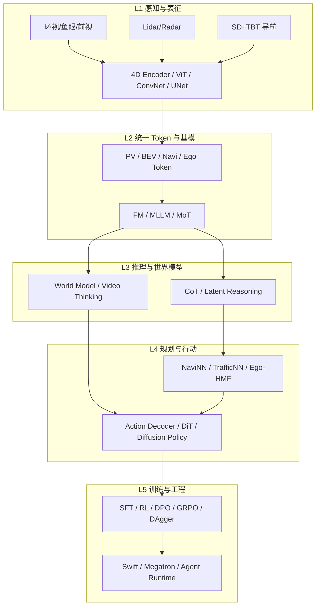

# 整体知识体系分析

> 基于 28 页手写笔记的归纳。笔记覆盖：**端到端自动驾驶感知–规划**、**4D/流式多模态基模**、**VLM/World Model/VLA**、**SFT–RL–偏好优化**、以及 **Swift/Megatron 训练工程**。

---

## 1. 一句话定位

这套笔记描述的是一条从「多传感器时空感知」到「大模型推理与动作生成」的完整技术栈，目标形态是：

**流式 4D 感知 Token → Foundation Model / MLLM（理解与推理）→ DiT / Action Decoder（规划与控制）**，并用 **SFT → RL / DPO / GRPO** 与闭环数据（DAgger、路测、仿真）持续迭代。

---

## 2. 能力分层（推荐阅读顺序）

| 层级 | 核心问题 | 笔记中的关键词 |
|------|----------|----------------|
| L1 感知 | 如何从多相机/点云得到时空一致特征？ | PV/BEV、LSS、4D Encoder、Ray/Depth、Sparse BEV |
| L2 表征 | 如何压成可进 LLM/FM 的 Token？ | tokenizer、~1000 tokens、KV Cache、2D/4D adaptor |
| L3 推理 | 如何做长时理解与未来推演？ | CoT、Latent Reasoning、WM、Video Thinking、Scene Graph |
| L4 行动 | 如何输出轨迹/动作并满足约束？ | Action Decoder、DiT、waypoints、STL、Classifier Guidance |
| L5 训练/工程 | 如何稳定放大并落地？ | SFT→RL、Toggle、DAgger、Swift+Megatron、评测闭环 |

---

## 3. 三条技术主线

### 主线 A：感知栈升级（传统多头 → 4D 流式基模）

1. **经典多任务感知**：Cam + RL → BEV fusion → Lane / GOD / Driveable / Sparse Det（见感知大图）。
2. **4D Encoder**：输出 Depth / Ray Map / Semantic；兼容鱼眼、Lidar、MOT。
3. **流式状态**：SSM + Attn + KV Cache；时间窗如 `6s / 2s @ 2Hz`。
4. **多模 4D 混训路线**：`4D Encoder pretrain → Point 4D projector → 2D/4D 混训 → SFT → RL`。

### 主线 B：从理解到行动（FM → MLLM → DiT）

1. **档位演进**：Max（~0.13B）→ Ultra（~0.35B）→ Ultimate（FM/MLLM ~1.8B + DiT）。
2. **接口**：FM 特征经 MLP/RMSNorm → AZ Cross-Attn → lm-head；条件（ego/time/point）进 DiT 出 waypoints。
3. **推理形态**：结构化 CoT（DriveLM）、自适应深度 CoT（ThinkDrive）、视觉 CoT（FSDrive：先预测未来帧再规划）。
4. **约束**：STL / Classifier Guidance 注入规则，抑制规划坍缩与违例。

### 主线 C：对齐与压缩（数据效率 × Token 预算）

1. **蒸馏**：Teacher soft 分布 + student rollout；OPD/MOPD；单 token KL 降算力。
2. **偏好/策略优化**：SFT → pairwise → DPO；GRPO/PPO；Toggle 交替「省 token」与「提能力」。
3. **模仿闭环**：DAgger + dense depth；RL 纵向 ARDP（交互推演 / 语义风险降速）。
4. **Reward 设计**：感知/推理/决策一致性；CoC 与 TBT、轨迹对齐；防 reward hacking。

---

## 4. 产品形态与评测闭环

笔记反复强调「大模型原生」而非模块拼装：

| 阶段 | 内容 | 评测 |
|------|------|------|
| 基本面 | Transformer → MoT，统一表征 | 感知指标、Depth/BEV/Seg |
| 拓展 | Memory、WM、离散+连续、CFG | VQA/C-Eval、难例通过率 |
| 闭环 | 仿真平台 + 路测 + 数据回流 | Planning Acc/Diversity、TTC、碰撞 |
| 部署 | 高效部署、统一表征空间 | Hz（如 7B@3Hz，3B@5–8Hz） |

具身侧平行链路：`human data → 物理交互 → 复杂任务 → FM → 真机`，强调力觉柔顺、视触关节多模态、Memory Bank（衰减但不消失）。

---

## 5. 概念词典（高频缩写纠错）

| 缩写 | 推荐释义 | 易混项 |
|------|----------|--------|
| PV / BEV | Perspective View / Bird’s-Eye View | — |
| FM / MLLM | Foundation Model / Multimodal LLM | — |
| MoT | Mixture of Transformers（多模态融合语境） | 勿与 MOT（跟踪）混淆 |
| MOT | Multi-Object Tracking | — |
| DiT | Diffusion Transformer | — |
| WM | World Model | — |
| TBT | Turn-By-Turn 导航 | — |
| SD | Standard Definition Map | — |
| LSS | Lift-Splat-Shoot | — |
| DAgger | Dataset Aggregation | 笔记常写 Dagger |
| GRPO | Group Relative Policy Optimization | — |
| DPO | Direct Preference Optimization | — |
| STL | Signal Temporal Logic | — |
| ARDP | 自回归/纵向决策规划模块（项目内） | — |
| BCG / BZL / GOD / COG | BEV 任务头（边界/障碍/认知等，以项目定义为准） | — |
| CoC | 笔记中的因果/决策链评分项；勿一律改成 CoT | 与 CoT 区分 |
| Swift | ModelScope SWIFT 训练框架 | 非 Apple Swift |
| PE | Positional Encoding | — |
| KV Cache | Key-Value Cache | — |
| SSM | State Space Model | — |

---

## 6. 知识缺口与待确认项

笔记中若干专名需对照内部文档确认，整理时已保留原文并标注：

- **OPD / MOPD**：蒸馏或离线策略相关内部方法名。
- **PAC、TempCompass、SRPP、AZ**：模块/项目代号。
- **BCG / BZL / GOD / COG**：BEV 头的精确任务定义。
- **mindVLA-U1 / Xiaomi OneVL**：外部/对标模型，建议对照公开资料更新。
- **WAN 2.2**：视频生成模型版本（Wan 系列）。
- 「西北最优方案」等字迹：可能为项目/机房简称，未强行改写。

---

## 7. 建议的后续沉淀方式

1. 把 **主题笔记** 当作「设计说明书」，**Know-how** 当作「原理+落地 checklist」。
2. 每个新实验在对应主题页追加「实验记录」小节，避免再散落在纸上。
3. 对未确认缩写维护一张活字典（本文件第 5 节），合并进团队 wiki。
